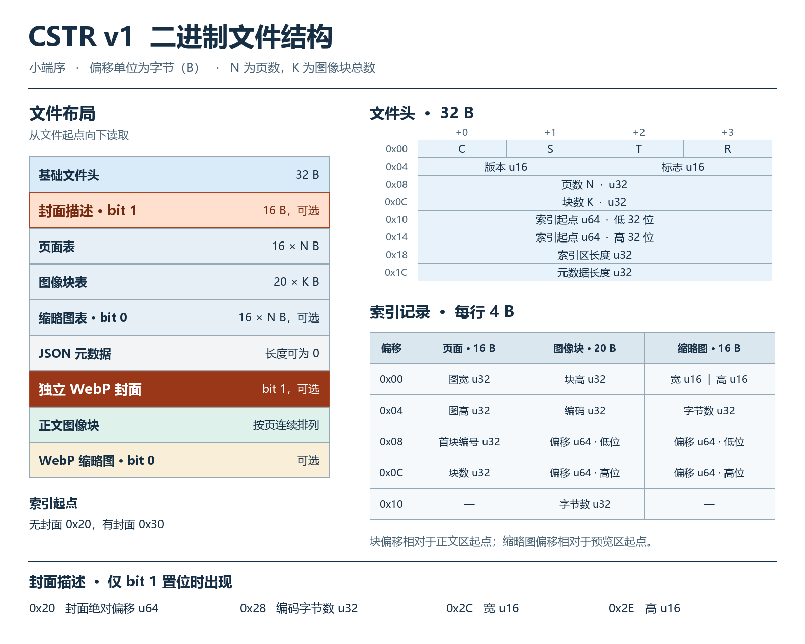
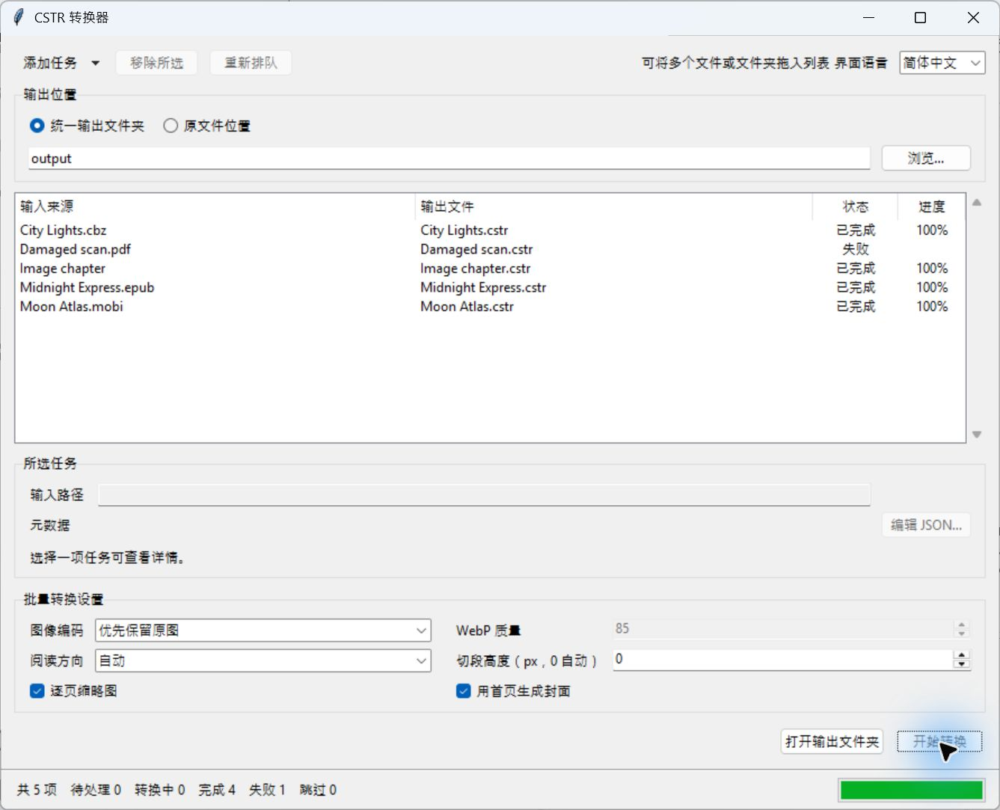

# ComicStream

[English](README.md) · 简体中文

CSTR（`.cstr`）是为流式阅读优化的漫画文件格式。文件开头的二进制索引记录每页的尺寸和图像块位置，阅读器可以通过 HTTP Range 按需加载指定页、长条漫的可见分段或某页的完整缩略图。ComicStream 提供桌面和命令行转换器、Windows 阅读样板及浏览器阅读器。

## CSTR 文件布局



```text
[文件头][封面描述*][页表][块表][缩略图表*][JSON 元数据*][封面 WebP*][正文图像块][缩略图数据*]

* 可选。文件头标志位 bit 0 启用缩略图；bit 1 启用独立封面。
```

| 区段 | 记录内容 | 阅读器如何使用 |
| --- | --- | --- |
| 文件头（32 字节） | `CSTR` 魔数、版本、标志位、页数、块数、索引位置和长度、元数据长度 | 确定索引和后续区段的位置 |
| 页表（每页 16 字节） | 页宽、页高、首块下标、块数 | 找到第 N 页对应的连续块，并预留页面空间 |
| 块表（每块 20 字节） | 块高、编码、相对正文起点的偏移、字节长度 | 按块高定位页内位置，按偏移和长度读取图像 |
| 缩略图表（每页 16 字节，可选） | 图像宽高、字节长度、相对缩略图区起点的偏移 | 直接读取一张完整的小图，或合并读取相邻多张 |
| JSON 元数据（可选） | UTF-8 对象，如 `title` 和 `readingDirection` | 设置标题和翻页方向 |
| 正文图像块 | 按页序紧密排列的独立单帧图像，每块占满所属页的宽度 | 普通页通常读取一块，长条漫可按视口读取其中几块 |
| 缩略图数据（可选） | 按页序紧密排列的完整单帧 WebP | 打开预览时读取所需小图 |

当前格式为 **CSTR v1**。多字节整数按小端序存放，页号和块号从零开始。标志位 0 和 1 分别控制逐页缩略图和独立封面。 [二进制规范与字节样包](CSTR-v1.zh-CN.md)

## 从索引定位图像

1. 读取文件头和索引。正文起点是 `index_offset + index_size + meta_size + cover_size`（无封面时 cover_size 为 0）。
2. 从页表找到该页的块。页内各块自上而下排列，前面各块的高度之和就是当前块的纵坐标。正文块的文件起点是 `正文起点 + chunk.offset`。
3. 缩略图区从最后一块正文结束的位置开始。某页小图的文件起点是 `缩略图区起点 + thumbnail.offset`。读取该记录的 `size` 字节即可得到完整 WebP。

文件内的半开区间 `[start, end)` 对应 HTTP 请求头 `Range: bytes=start-(end-1)`。例如样包的首块位于 `[142, 178)`，请求 `Range: bytes=142-177` 就能取得该块。相邻块或相邻缩略图可以合并成一次请求，再按索引拆分。 [HTTP Range 读取](CSTR-v1.zh-CN.md#2-http-流式读取) · [字节样包](CSTR-v1.zh-CN.md#3-字节样包)

`readingDirection` 可取 `ltr`（从左向右）、`rtl`（从右向左）或 `ttb`（从上向下）。索引始终按实际阅读顺序排列。浏览器阅读器据此调整翻页控件，`rtl` 也会反转左右方向键和缩略图排列。正文支持连续滚动。

## Windows 桌面转换器



双击 `CSTR-Converter.exe`，通过「添加任务」导入 CBZ/ZIP、CBR/RAR、CB7/7Z、CBT/TAR、PDF、EPUB、MOBI、AZW、AZW3 或 JSON 图片清单。也可以从资源管理器一次拖入多个文件和图片文件夹。每个压缩包、电子书、PDF、清单或图片文件夹分别成为一项任务，同批散图合成一项。图片文件夹包含子文件夹中的图片。不支持的文件会跳过，列表上方会显示忽略数量。

窗口右上角可切换简体中文和 English，选择会在下次启动时保留。PDF 按原页序渲染为图像，常规页面使用 144 DPI。CBR、CB7 和 CBT 使用 Windows 自带的 `tar.exe` 解包，兼容性取决于系统版本。当前桌面版处理无需密码的文件。

EPUB 和 Kindle 图像漫画按书内阅读顺序提取图像页，并读取书名和阅读方向。MOBI、AZW 和 AZW3 需要 calibre 的 `ebook-convert`。转换器优先使用 EXE 旁的 `calibre` 文件夹，再查找系统路径和默认安装目录。可用 `CSTR_EBOOK_CONVERT` 指定程序的完整路径。需要保留文字重排或矢量版式的电子书可先导出为 PDF。 [calibre Windows 下载](https://calibre-ebook.com/download_windows)

「统一输出文件夹」将所有待处理任务写到同一个文件夹，初始值为首项来源所在的目录。选择「原文件位置」时，每个 `.cstr` 会写到对应的压缩包、清单或图片文件夹旁边。散图任务写到第一张图片所在的文件夹。输出文件根据来源自动命名，队列中同一目标目录里的同名输出会加序号。

「逐页缩略图」和「用首页生成封面」默认勾选，可在「批量转换设置」中关闭。

选中任务后点击「编辑 JSON…」，可导入 UTF-8 JSON 文件，也可以直接编辑对象，例如 `{"title": "漫画名", "readingDirection": "rtl"}`。点击「应用」后，转换时会将字段写入该任务的 `.cstr`。批量设置中指定的阅读方向优先于 JSON 中的设置。清空编辑框并应用即可移除元数据。

点击「开始转换」执行待处理任务。列表显示每项的状态和进度，窗口底部显示任务总数及结果。选中失败项可查看原因。修正问题后，选中该项并点击「重新排队」即可重试，其他任务会继续转换。

EXE 自带运行环境。要从源码构建，在 Windows 的项目目录运行以下命令。生成文件位于 `dist/CSTR-Converter.exe`。

~~~powershell
python -m pip install -r requirements-build.txt
.\build_converter.ps1
~~~

也可安装 `requirements.txt` 后直接运行 `python converter.py` 调试桌面界面。

## Windows 桌面阅读样板

双击 `CSTR-Reader.exe`，可以选择或拖入本地 `.cstr` 文件，也可输入支持 HTTP Range 的漫画链接。正文按可见图像块读取。带有独立封面或逐页缩略图的文件会显示对应入口。支持按页跳转和键盘翻页。右上角可切换简体中文和 English，切换时保留当前页，下次启动也会沿用所选语言。

桌面阅读器用 Tkinter 显示窗口，用 Pillow 解码图像。其读取流程与 ScrapeFun 一样，先读取索引，再按需读取可见图像块、缩略图或封面。支持页内纵向滚动，方向键遵循漫画的阅读方向。远程文件通过 HTTP(S) Range 读取。浏览器版继续使用 TypeScript 实现。

~~~powershell
python -m pip install -r requirements-build.txt
.\build_reader.ps1
~~~

生成文件位于 `dist/CSTR-Reader.exe`。若要从源码启动，安装 `requirements.txt` 后运行 `python desktop_reader.py`。

## Windows 便携版

将 `ComicStream-Portable-Lite-win-x64.zip` 完整解压到 Windows 10（1809 或更新版本）或 Windows 11 上可写的本地文件夹。包内包含 `CSTR-Converter.exe`、`CSTR-Reader.exe`、`CSTR.exe` 和 calibre 转换运行时。本地阅读和 Kindle 格式转换都可离线使用。设置与运行时数据保存在 EXE 旁的 `Data` 文件夹。换电脑时一起移动整个文件夹。

[在 GitHub Releases 下载 Windows 便携版](https://github.com/HaoweiLi97/ComicStream/releases/latest)

如需重建 ZIP，安装构建依赖，并指定已展开的 x64 calibre 程序目录。打包 calibre 9.19.0 时会省去它自带的阅读器、编辑器和朗读组件。 [calibre Windows 下载](https://calibre-ebook.com/download_windows)

~~~powershell
python -m pip install -r requirements-build.txt
.\build_portable.ps1 -CalibreDirectory 'C:\build\Calibre2'
~~~

## 使用命令行转换漫画

在便携版目录中打开 PowerShell，运行 `CSTR.exe`。可重复使用 `-i`，混合导入桌面版支持的格式和图片文件夹。

~~~powershell
.\CSTR.exe --help
.\CSTR.exe -i book.cbz -i book.mobi -i "图片文件夹" -d output
.\CSTR.exe -i book.epub --list-pages
.\CSTR.exe -i book.pdf -o book.cstr --no-thumbnails --no-cover
~~~

每个 `-i` 创建一项任务。省略 `-d` 时，输出写到各输入旁边。同批中目标重名会加序号。覆盖已有文件需加 `--overwrite`。单项失败会写入标准错误，其余任务继续执行。有任务失败时，进程退出码为 1。使用 `-i` 时默认生成逐页缩略图和首页封面。要将多张散图合成一本，可继续使用位置参数。

### 从源码运行或沿用原脚本

`python pack.py` 接受相同参数，需要 Python 3.10+。导入 AVIF 需要安装支持 AVIF 的 Pillow。原有的 CBZ、清单与散图用法仍可使用，封面和缩略图由参数开启。

~~~powershell
py -m pip install -r requirements.txt
py pack.py --cbz book.cbz --list-pages
py pack.py --cbz book.cbz -o book.cstr
py pack.py --cbz book.cbz --thumbnails --reading-direction rtl -o book.cstr
py pack.py --cbz book.cbz --webp -o book-webp.cstr
py pack.py --cbz webtoon.cbz --strip-height 1600 -o webtoon.cstr
py pack.py -o book.cstr 10.png 2.png 1.png
~~~

所有输入都按路径逐级自然排序。`chapter 2/1.png` 在 `chapter 10/1.png` 之前，同目录下的 `1.png`、`2.png`、`10.png` 按数字顺序排列。也可以用 `--manifest pages.json` 指定参加打包的图片。清单是 JSON 字符串数组，路径相对于清单文件。`--list-pages` 可与以上任一种输入配合使用。

整页 JPEG、PNG、WebP 和 AVIF 在符合读取上限且无需校正方向或布局时，保留原始字节。需要校正、切段或格式转换的页面会编码为 WebP。单帧 GIF、BMP 和 TIFF 可通过转换导入。打包器会拒绝动画等多帧输入。

阅读器每块最多允许 128 MiB 的 RGBA 解码预算和 32 MiB 的压缩数据。可用 `--strip-height` 指定每段最大高度。面向只支持 WebP 的阅读器时，可用 `--webp` 强制转换，也可以用 `--quality` 指定 WebP 质量或用 `--lossless` 写出无损 WebP。

`--thumbnails` 为每页嵌入一张 WebP 缩略图。小图保持比例，以宽至少 160 像素、高至少 224 像素为目标。极长页取顶部，极宽页取中央，原图太小时保留可用像素。`--metadata` 接受 UTF-8 JSON 对象。用 `--reading-direction ltr|rtl|ttb` 设置方向，命令行值优先于元数据文件。

ComicStream 打包器和阅读器采用相同的上限。索引区最多 8 MiB，JSON 元数据最多 256 KiB，均按写入文件的字节数计算。

## 独立封面

`--cover` 从第一页原图生成单帧 WebP。也可以用 `--cover-page 3` 指定自然排序后的第 3 页，或通过 `--cover-file` 使用外部图片。任何封面选项都会启用独立封面，无需开启逐页缩略图。

~~~sh
python pack.py --cbz book.cbz --cover -o book.cstr
python pack.py --cbz book.cbz --cover-file art.jpg --cover-width 1200 --cover-height 1800 --cover-kib 1024 --cover-quality 85 -o book.cstr
~~~

默认边界框 640 × 909，质量 85，预算 128 KiB。可自定义宽高（各 1–2560）、体积（1–2048 KiB）和质量（0–100）。图像等比缩小；超出预算时继续缩小。外部原图上限为 32 MiB、3200 万像素。封面紧接索引和可选元数据。书架可调用 `readCover(source)` 获取尺寸和 WebP 字节。未提供封面选项时继续生成原布局；旧读者需更新才能打开带封面的包。

## 浏览器阅读

需要 Node.js 24+。

~~~powershell
npm ci
npm run build
npm start
~~~

在浏览器打开 `http://127.0.0.1:4173`，选择本地 `.cstr` 或输入 HTTP(S) 地址。可以用页码、上一页和下一页跳转。阅读区获得焦点时也支持左右方向键。

如果正文索引有效且正文块的字节范围完整，缩略图索引损坏或包尾的缩略图区截断时，阅读器会提示并关闭页面预览，正文仍可阅读。

本地开发服务器为 `library` 目录中的 `.cstr` 提供 Range 读取。`library/book.cstr` 可通过同源链接 `/library/book.cstr` 打开。远程服务应支持单区间 Range 和原始字节传输。跨域时需允许页面来源并暴露 `Content-Range`、`ETag`。同一地址对应的内容会更新时，勾选“链接内容可能更新”，该服务需提供强 ETag 并允许 `If-Range`。

## 验证

~~~powershell
npm test
py tests/create_fixture.py
py tests/native_reader.py
~~~

生成样本后，保持 `npm start` 运行。安装 Python Playwright 和 Chromium 后，执行 `py tests/browser.py` 验证浏览器本地打开、HTTP Range、乱序下载和跳页。可通过 `CSTR_CHROME` 指定已安装浏览器，通过 `CSTR_PORT` 改端口。

## 开源许可证

ComicStream 源码和文档采用 MIT 许可证。便携包里的第三方组件沿用各自的许可证。ZIP 内附有第三方许可证声明，以及 GPL v3 下的 calibre 对应源码链接。 [MIT 许可证](LICENSE)
